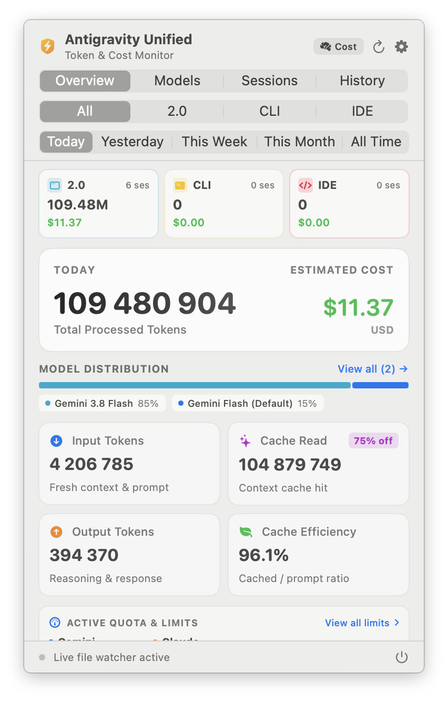
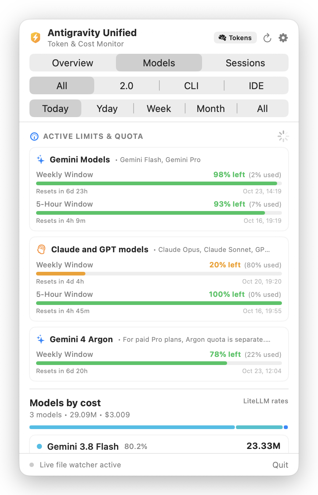
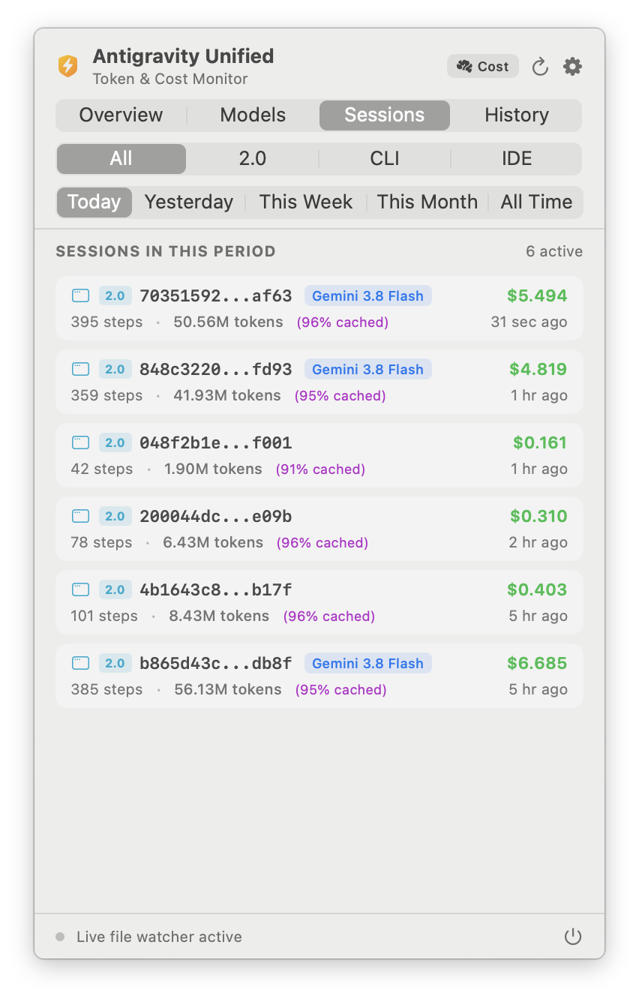
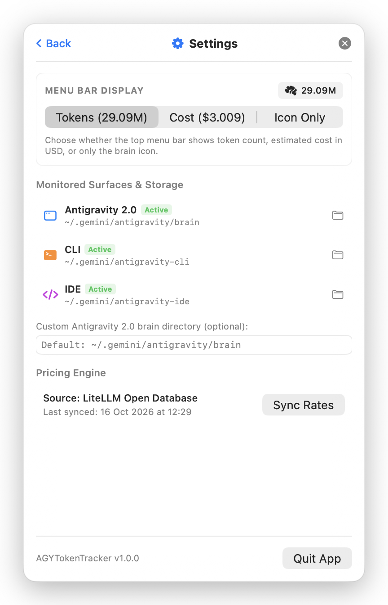

# AGY Token Tracker (Antigravity Unified Menu Bar Monitor) ⚡️

[](https://apple.com)
[](https://swift.org)
[](https://opensource.org/licenses/MIT)

**AGY Token Tracker** is a lightweight, native macOS menu bar application designed to monitor token usage, prompt caching efficiency, real-time expenses, and rate limit quotas across the entire **Google Antigravity** ecosystem:

1. 🖥️ **Antigravity 2.0 (Desktop)**
2. 💻 **Antigravity CLI (`agy`)**
3. 📝 **Antigravity IDE (VS Code Extension & Language Server)**

Built entirely with **SwiftUI** and **AppKit** with a modern Liquid Glass aesthetic, it lives quietly in your menu bar (`LSUIElement`, no Dock icon clutter) and updates automatically in the background.

<p align="center">
  
</p>

---

## 📸 Screenshots

| Overview (Tokens & Cost) | Models Analytics & Quotas |
| :---: | :---: |
|  |  |
| **Sessions History** | **Settings & Preferences** |
|  |  |

---

## ✨ Features

### 🌐 Multi-Surface Unified Tracking
- **Unified Overview (All Surfaces)**: Global metrics with interactive breakdown cards summarizing each environment at a glance.
- **Antigravity 2.0 (Desktop)**: Monitors session trajectories from `~/.gemini/antigravity/brain/**/transcript.jsonl`.
- **Antigravity CLI (`agy`)**: Scans console sessions and trajectory databases from `~/.gemini/antigravity-cli`.
- **Antigravity IDE**: Parses IDE extensions and workspace conversations from `~/.gemini/antigravity-ide`.

### ⏱️ Flexible Time Horizons
- **Today**
- **Yesterday**
- **This Week**
- **This Month**
- **All Time**

### 📊 Granular Token & Cache Accounting
- 📥 **Input Tokens**: Fresh context and user prompts.
- ⚡️ **Cache Read Tokens**: Cached context (Prompt Caching) taking advantage of standard ~75–80% cost savings.
- 📤 **Output Tokens**: Model responses including reasoning / thinking tokens.
- 🎯 **Cache Efficiency**: Real-time Cache Hit Ratio (%) to evaluate context optimization.

### 💳 Real-Time Cost Estimation ($ USD)
- **Dynamic Pricing Engine**: Automatically downloads and caches the latest model pricing from the open [LiteLLM catalog](https://github.com/BerriAI/litellm) (`model_prices_and_context_window.json`).
- **Comprehensive Offline Fallbacks**: Built-in pricing tables covering the latest **Gemini 4 / 3.8** family (Flash, Pro, etc.), **Claude 5.5 / 3.7**, and other major models.

### ⏱️ Live Quotas & Limits Monitoring
- **Real-time Quota Fetching**: Queries `agy --print /usage --output-format json` asynchronously with safe fallback parsing.
- **Visual Limit Gauges**: Tracks remaining quota fractions across rolling windows (e.g., Weekly limits, 5-hour rolling windows).
- **Reset Timestamps & Countdowns**: Displays exact reset dates and formatted countdowns.
- **Resilient Local Caching**: Persists last-known quota state in `UserDefaults` so the UI remains instantaneous on launch.

### 🤖 Models Analytics & Interactive Filtering
- 📊 **Model Distribution Bar**: Proportional color-coded indicator (similar to GitHub's language bar) with interactive chips.
- 🔍 **Interactive Filtering**: Click any model chip or card to instantly filter recent sessions to that specific model; clear filters with a single click.
- 📑 **Sessions / Models Toggle**: Effortlessly switch between chronological conversation history and per-model consumption summaries.

### ⚡️ Dual-Layer High-Performance Parsing
- **Streaming JSONL Parser**: Reads desktop planner trajectories incrementally without memory spikes.
- **Zero-Dependency SQLite & Protobuf Decoder**: Inspects CLI and IDE SQLite databases and directly decodes wire-format Google Protobuf blobs (`gen_metadata`) without external C++ libraries.
- **Filesystem Observers (FSEvents)**: Instantly invalidates and updates caches when conversation files change, using file modification times (`mtime`) to avoid redundant re-parsing.

### ⚙️ Menu Bar Customization & Settings
- **Status Bar Display Options**: Show estimated Cost (`$0.24`), Token count (`125k`), combined, or Icon only.
- **Path Health Indicators**: Live status indicators for all monitored directories with direct "Reveal in Finder" actions.
- **Custom Path Overrides**: Option to configure a custom Antigravity `brain` directory.
- **Manual Pricing Sync**: One-click update for LiteLLM tariff rates.

---

## 🛠️ Build & Installation

### Requirements
- macOS 14.0 (Sonoma) or newer (Apple Silicon & Intel).
- Xcode 15+ or Command Line Tools (`swift`).

### 1. Run in Development Mode
Clone the repository and launch directly:
```bash
git clone https://github.com/rsimenok/agy-token-traker.git
cd agy-token-traker
swift run
```

### 2. Run Test Suite
```bash
swift test
```

### 3. Build Standalone `.app` Bundle
Use the included build script to package a production `.app`:
```bash
./scripts/build_app.sh
```
The output bundle will be located at `build/AGYTokenTracker.app`.

Launch it immediately:
```bash
open build/AGYTokenTracker.app
```
Or copy it to your Applications folder:
```bash
cp -r build/AGYTokenTracker.app /Applications/
```

---

## 📂 Project Architecture

```text
Sources/AGYTokenTracker/
├── AGYTokenTracker.swift              # App entry point (@main) with MenuBarExtra (.window)
├── Models/
│   ├── AppSurface.swift               # Surface definitions (.all, .desktop, .cli, .ide)
│   ├── TokenStep.swift                # Individual step metrics & SessionSummary
│   ├── TimePeriod.swift               # Date-range filtering logic
│   ├── ModelPricing.swift             # Model pricing rules & currency calculations
│   ├── ModelQuota.swift               # Quota groups, buckets, and reset timestamps
│   └── ModelUsage.swift               # Aggregated per-model statistics & color palette
├── Services/
│   ├── UnifiedScanner.swift           # Central coordinator aggregating all surfaces
│   ├── TranscriptScanner.swift        # Streaming parser for desktop transcript.jsonl
│   ├── SQLiteConversationScanner.swift# SQLite + wire-format Protobuf decoder for CLI & IDE
│   ├── QuotaService.swift             # Live /usage quota discovery, parsing, and caching
│   ├── PricingService.swift           # LiteLLM catalog sync + built-in fallback tariffs
│   └── FolderWatcher.swift            # FSEvents & DispatchSource multi-directory observer
├── ViewModels/
│   └── TrackerViewModel.swift         # Observable coordinator managing state & filtering
└── Views/
    ├── StatusItemLabel.swift          # Menu bar icon & dynamic label formatting
    ├── DashboardView.swift            # Main popover UI with period & surface tabs
    ├── HeroStatsCard.swift            # Primary summary card for total tokens & cost
    ├── MetricCardView.swift           # 2x2 grid for Input / Cache / Output / Efficiency
    ├── ModelUsageRowView.swift        # Model cards & proportional distribution bar
    ├── SessionRowView.swift           # Session list item with colored surface badges
    └── SettingsSheet.swift            # Preferences sheet, directory status & sync
```

---

## 🤝 Contributing

Contributions, issue reports, and feature suggestions are welcome!
Feel free to open an issue or submit a Pull Request on [GitHub](https://github.com/rsimenok/agy-token-traker).

---

## 📄 License

This project is licensed under the [MIT License](LICENSE).
